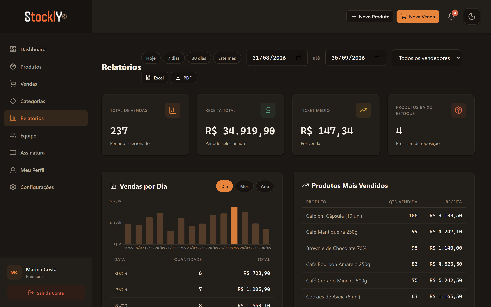
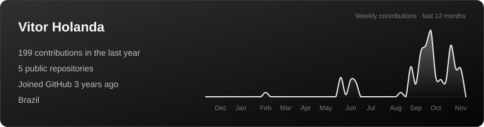
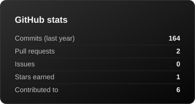
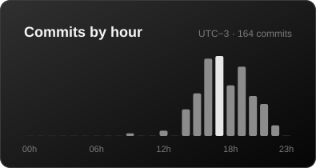

  
  
  

## 👨‍💻 About me

- Software Engineer from Brazil, graduated in **Systems Analysis and Development** and studying **Software Engineering**

- Built **Stockly**, a multi-tenant inventory management SaaS, now live in production

- Currently building **Brillare**, a full e-commerce platform with a storefront, an owner's dashboard and a mobile app, in a TypeScript monorepo with Next.js, Express 5 and PostgreSQL

- I like typed APIs, clean architecture and interfaces that feel good to use

- Learning more about payments integration, end-to-end testing and monorepo tooling

- Ask me about **TypeScript**, **React**, **Next.js** and **Node.js**

## 🛠️ Tech stack

  
   
  TypeScript · Node.js · React · Next.js · Express · Vite · Tailwind CSS · MongoDB · PostgreSQL · Prisma · Zod · Docker · AWS · CI/CD with GitHub Actions · Vitest · Playwright · pnpm + Turborepo · Git

## 🚀 Featured projects

<table>
  <tr>
    <td>
      <h3>📦 <a href="https://stockly.holandajvitor.workers.dev">Stockly</a>: inventory & sales management SaaS</h3>
      
A multi-tenant SaaS for small businesses to manage products, categories, sales and their team, with every company's data isolated from the others. Live in production.

      <a href="https://stockly.holandajvitor.workers.dev">
        <picture>
          <source media="(prefers-color-scheme: dark)" srcset="https://raw.githubusercontent.com/holandajvitor/holandajvitor/main/assets/stockly-reports-dark.png" />
          <source media="(prefers-color-scheme: light)" srcset="https://raw.githubusercontent.com/holandajvitor/holandajvitor/main/assets/stockly-reports-light.png" />
          
        </picture>
      </a>
      
Reports page with demo data

      <ul>
        <li>🔐 JWT authentication with roles (admin and seller), rate limiting and hardened headers</li>
        <li>🏢 Multi-tenant data isolation enforced at the repository layer</li>
        <li>⚡ Real-time notifications over WebSockets</li>
        <li>📊 Sales reports with charts and PDF/Excel export</li>
        <li>💳 Subscription flow with trial and premium plans</li>
        <li>🧪 Unit and integration tests (Jest, Supertest) plus E2E with Playwright</li>
        <li>🐳 Dockerized API, with type check, tests and image build on every push via GitHub Actions</li>
      </ul>
      

        
        
        
        
        
        
        
        
        
        
      

      

      🔒 Private repository · Frontend on Cloudflare Workers · API on Render · Database on MongoDB Atlas
    </td>
  </tr>
</table>

<table>
  <tr>
    <td>
      <h3>✦ Brillare: e-commerce platform (in progress)</h3>
      
An online store for religious articles and gifts: a responsive storefront, a separate dashboard for the store owner and, next, a mobile app for shoppers. Built as a pnpm + Turborepo monorepo with shared contracts, design tokens and UI between every app.

      <ul>
        <li>🛍️ Storefront and owner's dashboard in Next.js (App Router) with Tailwind CSS v4 and Radix UI</li>
        <li>🧩 REST API in Express 5 with Prisma and PostgreSQL, layered into controllers, services and repositories</li>
        <li>📐 Shared Zod schemas and a typed API client, so the API and the fronts speak the same contracts</li>
        <li>💳 Checkout with Mercado Pago (PIX, card, boleto), signed webhooks and idempotent orders</li>
        <li>📦 Shipping quotes with Melhor Envio, product photos on Cloudinary and transactional e-mails</li>
        <li>🔒 Atomic stock reservation, so the last unit is never sold twice</li>
        <li>🧪 Vitest unit tests, integration tests on a real PostgreSQL with Testcontainers, and E2E with Playwright, axe and Lighthouse</li>
        <li>🚫 Strict TypeScript with zero <code>any</code>, enforced by ESLint and by CI on every push</li>
      </ul>
      

        
        
        
        
        
        
        
        
        
        
        
        
      

      🔒 Private repository · Mercado Pago · Melhor Envio · Cloudinary · Docker for local PostgreSQL and Mailpit
    </td>
  </tr>
</table>

## 📊 GitHub stats

  
   
  
  

